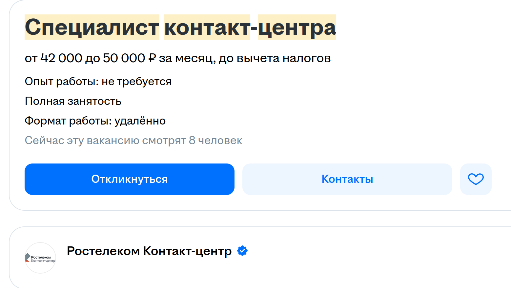

# ML Salary Predictor

Прогноз нижней и верхней границы зарплаты по тексту вакансии. Модель использует `cointegrated/rubert-tiny2` и регрессионную голову с двумя выходами

## Что есть в проекте

- [Подготовка данных](training/data_cleaning.py) и [обучение модели](training/train.py)
- [FastAPI-сервис](server/server.py) с эндпоинтом `POST /predict`
- [Telegram-бот](app/bot.py), который отправляет описание вакансии в API и показывает прогноз
- Dockerfile для сервиса и бота, [Compose-конфигурация](compose.yml)

Пример запроса к API:

```bash
curl -X POST http://localhost:8000/predict \
  -H 'Content-Type: application/json' \
  -d '{"description":"Разработка ML-моделей на Python, анализ данных и работа с PyTorch"}'
```

Ответ содержит `salary_min` и `salary_max`. Бот переводит значения модели из тысяч рублей в рубли перед выводом

## Запуск

Для запуска нужен файл весов `model_weights.pth` в каталоге `server/`. Он не хранится в репозитории, поэтому без него API не запустится. Для бота дополнительно нужен `.env` с `BOT_TOKEN`

После подготовки весов и токена можно запустить контейнеры через `docker compose up --build`

Для повторного обучения потребуется исходный `train.csv`; он также не включён в репозиторий. Логика очистки и параметры выборки находятся в `training/`

## Примеры работы



Технологии: Python, PyTorch, Transformers, FastAPI, Telegram Bot API, Docker
